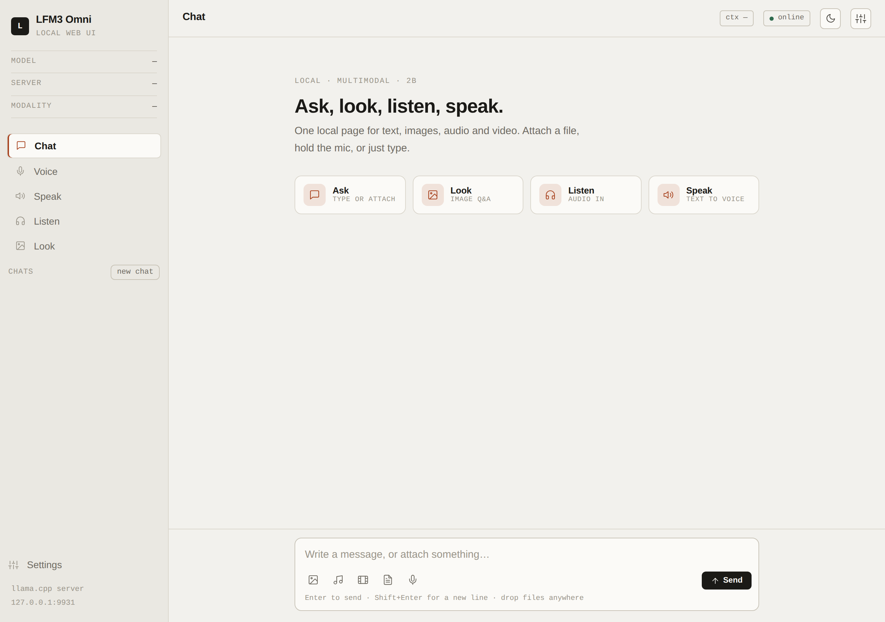

# LFM3 Omni Web UI

A local, single-page multimodal UI for **[LFM3 Omni 2B](https://github.com/ggerganov/llama.cpp)** running on **llama.cpp** — chat, image Q&A, audio transcription, text-to-speech, and a press-to-talk voice loop in one place.



## Why this exists

LFM3 Omni is a genuinely fun multimodal model to run locally. llama.cpp gives you the endpoints, but not one interface for trying every modality together. This is my side-quest wrapper: one small local page for text, images, audio, video, TTS, and voice — no cloud, no account, no framework.

## Features

- **Ask** — Text chat with interleaved multimodal output (text, images, audio, video)
- **Look** — Image understanding and visual Q&A
- **Listen** — Upload or record audio, transcribe it, then ask questions about the transcript
- **Speak** — Text-to-speech with language and voice selection
- **Voice** — Press-to-talk speech-to-text → LLM → TTS with a live waveform
- **Attachments** — Images, audio, video, and documents (PDF, etc.) via the composer or drag-and-drop
- **Chat history** — Chats are auto-saved to `outputs/chats/`, listed in the sidebar, and can be opened, renamed, or deleted
- **Chat audio player** — Per-message inline player with play/pause, seek, speed, and waveform
- **Voice output player** — Play/pause, scrub, speed control (1x–2x), and click-to-seek
- **Markdown & code** — Syntax-highlighted code blocks with copy-to-clipboard, plus inline mermaid diagrams
- **Responsive** — Mobile navigation drawer, touch-sized controls, safe-area support, and layouts down to 320px
- **Theme** — Light/dark theme toggle, remembered in local storage
- **No frontend build step** — Plain HTML, CSS, and JavaScript

## Prerequisites

- **Python 3.9+** — the server uses only the standard library
- **llama.cpp server** running with the LFM3 Omni model loaded
- **The `mmproj` file** (multimodal projector) next to the model — required for image, audio, and video input

```bash
# example llama.cpp server command (adjust paths to your build/model)
./llama-server \
  -m /path/to/lfm3-omni-2b.Q4_K_M.gguf \
  --mmproj /path/to/mmproj-lfm3-omni-2b-f16.gguf \
  -ngl 99 \
  --port 9931 \
  --ctx-size 32768
```

- `--mmproj` loads the multimodal projector GGUF. Without it, the server can chat over text but cannot understand images, audio, or video.
- `-ngl 99` offloads all model layers to the GPU. Lower it if you run out of VRAM, or use `-ngl 0` for CPU-only inference.

The Web UI expects the server at `http://127.0.0.1:9931` by default (configurable via `LFM3_LAMMA_URL`).

## Run

```bash
python3 app.py
```

Open **http://127.0.0.1:8090**

## Configuration

| Env var | Default | Description |
|---------|---------|-------------|
| `LFM3_LAMMA_URL` | `http://127.0.0.1:9931` | llama.cpp server base URL |
| `PORT` | `8090` | Web UI port |

Settings can also be adjusted from the Settings drawer in the UI (temperature, max tokens, server URL, voice).

## API routes

Served by `app.py` on the configured port:

- `GET /` — Web UI
- `GET /api/health` — llama.cpp server health & modalities
- `GET /api/models` — Available models
- `POST /api/chat` — Chat completions (SSE streaming) — proxies llama.cpp `/v1/chat/completions`
- `POST /api/tts` — Text-to-speech — proxies llama.cpp `/tts`
- `GET /api/chats` — List saved chats
- `POST /api/chats` — Save a chat
- `GET /api/chats/<id>` — Load a chat
- `DELETE /api/chats/<id>` — Delete a chat
- `GET /api/tts/<name>` — Download a generated TTS WAV file

## Project structure

```
app.py              # Python web server (http.server) + llama.cpp proxy
static/
  index.html        # Frontend HTML
  app.js            # Frontend application logic
  styles.css        # Styling
docs/               # Screenshots
outputs/
  tts/              # Generated TTS WAV files (gitignored)
  chats/            # Saved chat sessions (gitignored)
test/               # Sample media files
logs/               # Local runtime logs (gitignored)
```

## Notes

- Audio output is English-only for TTS.
- Multimodal input (images, audio, video) requires the `mmproj` file to be loaded with `--mmproj`.
- Max output tokens default to 32768 (full model limit); adjustable in Settings.
- Chats persist locally under `outputs/chats/`; no external database required.
- `outputs/` and `logs/` are gitignored so local conversations and generated audio do not end up in the repo.
